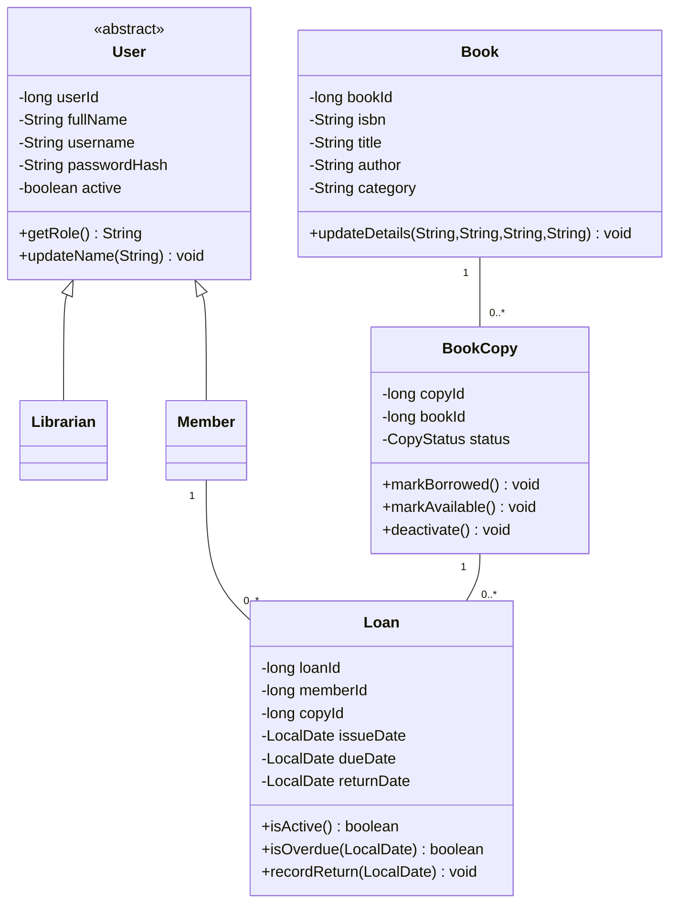
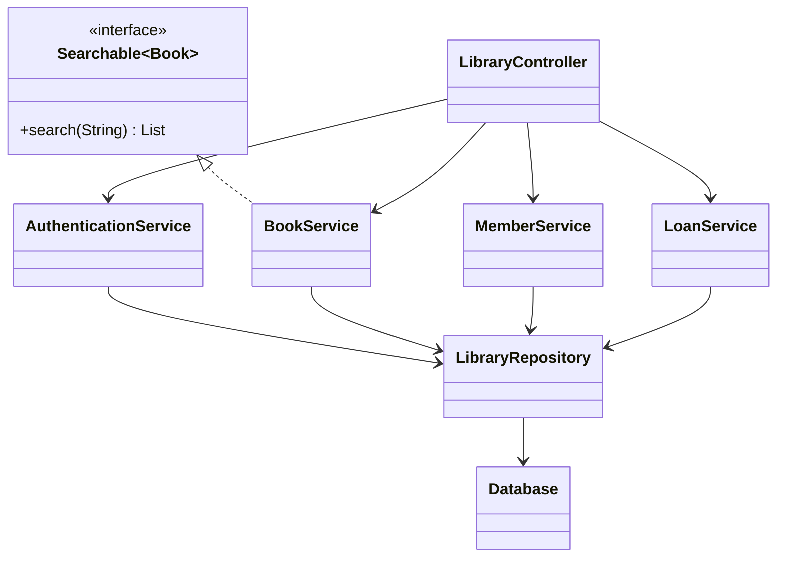

# Implemented system design

## Domain classes

Associations are implemented through IDs and database foreign keys rather than duplicated in-memory lists on each model. Every loan belongs to one member and one copy. Historical loans can reference a copy repeatedly, but only one may be active. `LoanStatus` is derived from `returnDate`; there is no independently mutable status field in the Java model. The database stores status with a check constraint to keep it consistent.

## Application components

`BookService.search(String)` delegates to overloaded `search(String, Field)`. `AuthenticationService` creates session objects; book, member and loan services require a valid session. One shared repository performs the small project's JDBC mapping.

## Changes from the supplied design

- The original service diagram proposed `BookRepository`, `BookCopyRepository` and `LoanRepository` interfaces. The implementation uses one concrete `LibraryRepository` to reduce repetitive files. `Searchable<T>` remains a purposeful interface.
- `Loan` explicitly includes member and copy IDs. It derives Java loan status from the return date to avoid conflicting model state.
- `BookCopy` holds `bookId`, making the persisted association explicit.
- `CopyStatus.INACTIVE` is used consistently, matching the original design document rather than the prompt's alternative example `WITHDRAWN`.
- Authentication, member management, UI and database classes are included in the component diagram; the supplied diagrams focused on domain, book and loan classes.

The original planning documents remain in `reference/` for comparison. These changes preserve their functional requirements.
