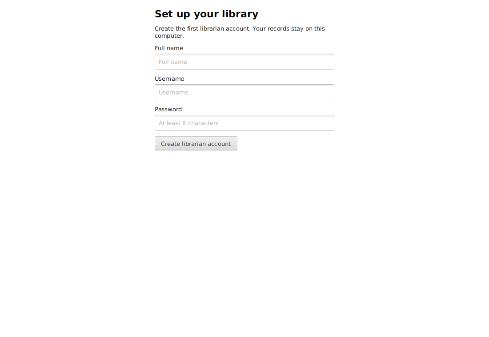
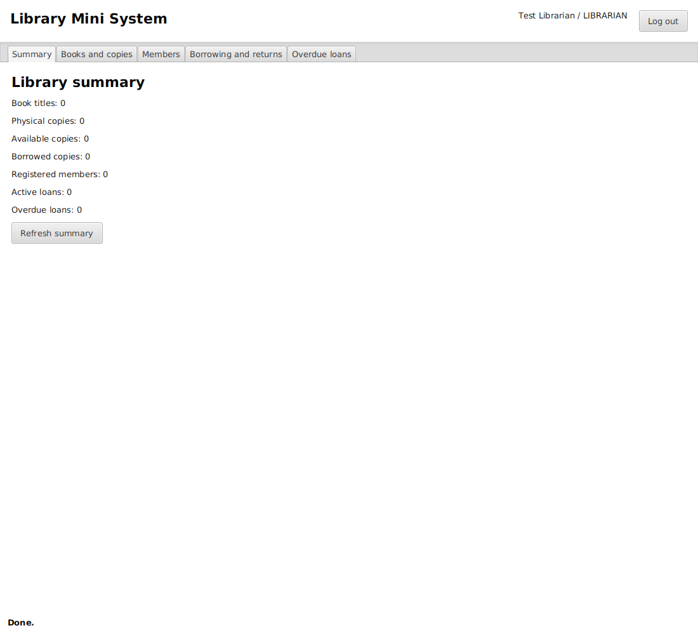
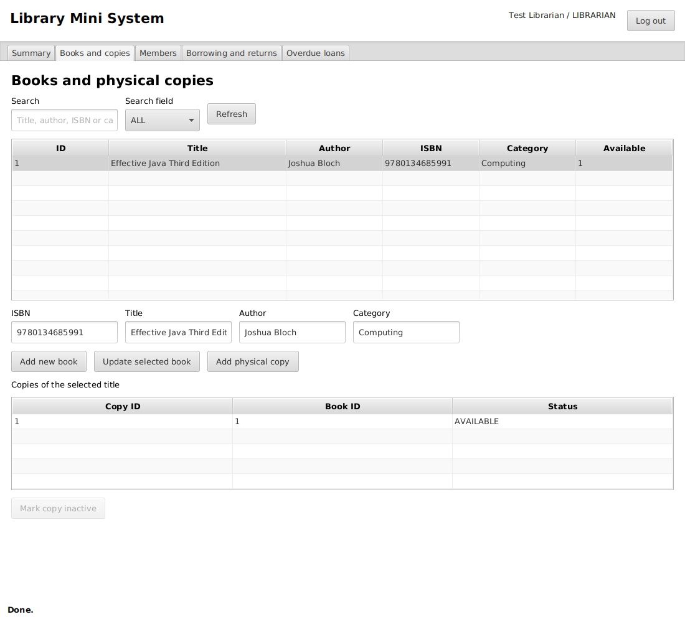
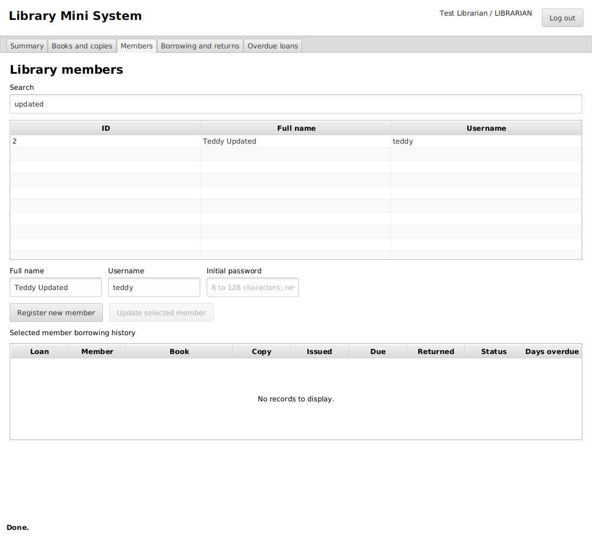
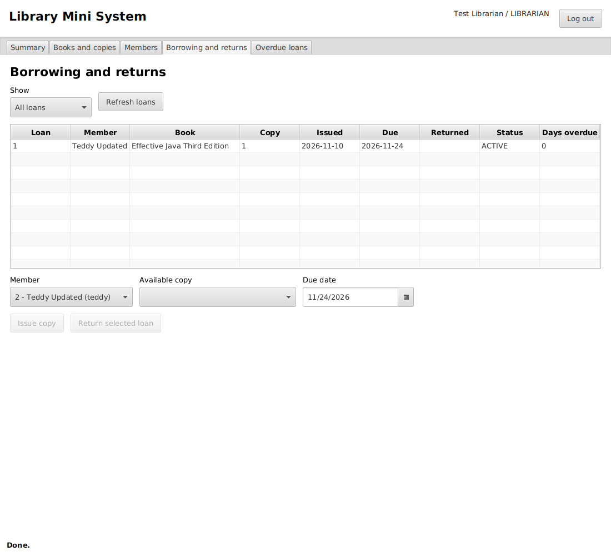
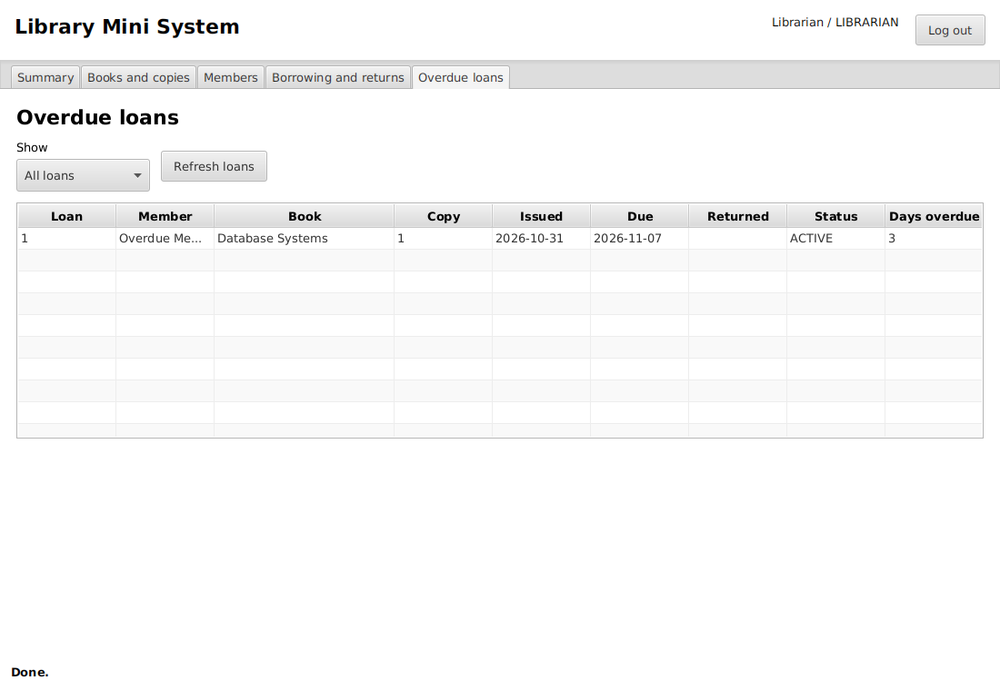
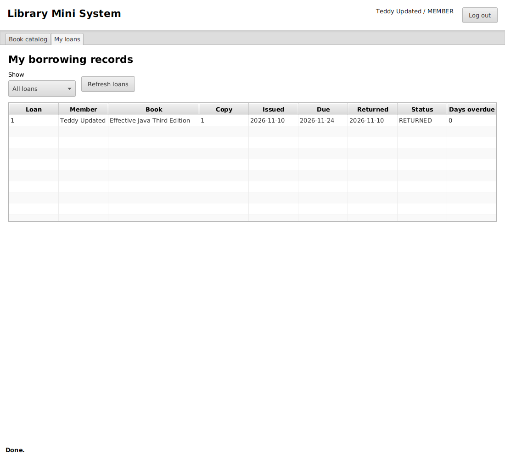

# User manual

## Start and sign in

Run `mvn clean javafx:run`. On first use, create the librarian account with your name, chosen username and password. On later launches enter the same username and password. Passwords are case-sensitive; usernames are matched without case sensitivity. Use Log out before another person uses the application.

## Librarian summary

The Summary tab shows totals for titles, physical copies, available copies, borrowed copies, members, active loans and overdue loans. Use Refresh summary to reload the figures. Inactive copies remain included in total physical copies but are not available for issuing.

## Register and edit books

Open Books and copies. Enter ISBN, title, author and category, then select Add new book. All four fields are required. The ISBN must be unique. This assignment treats an ISBN as a required catalog identifier; it does not implement a full ISBN checksum validator.

Select a book row to load its details. Change the fields and select Update selected book. Search by all fields or select Title, Author, ISBN or Category. Clear the search to show all titles. Hover over a shortened table value to read the full text.

## Register physical copies

Select a title and choose Add physical copy once for each actual copy. Each receives a unique ID. The lower table shows copies for the selected title. Available counts update from saved records.

To remove a copy from circulation, select its row and choose Mark copy inactive. Borrowed copies must be returned first. Inactive copies cannot be issued and are retained for history. There is no permanent deletion of circulation records.

## Register and edit members

Open Members. Enter a full name, unique username and initial password of 8 to 128 characters, then select Register new member. Give the member their credentials privately.

Select a member to display their details and loan history. Edit name or username and choose Update selected member. The initial-password field is used only during registration; updating details does not change the password. Search by name or username.

## Issue a book

Open Borrowing and returns. Select the member, an available physical copy and a due date, then choose Issue copy. The issue date is today. The due date cannot be before today. A successful issue adds a loan and removes that copy from the available-copy choices.

## Record a return

Select an active loan and choose Return selected loan. The return date is today. The loan becomes RETURNED and the physical copy becomes AVAILABLE. The return button is disabled for returned loans. Use the Show filter to display all, active or returned loans.

## Check overdue loans

Open Overdue loans to see active loans with due dates before today. The table includes member, title, copy ID, issue date, due date and days overdue. A loan due today is not overdue. Returned loans do not appear, even if they were returned late. No fines are calculated.

## Member use

Log in with a member account. Book catalog supports searching and shows available copies. My loans shows only that member's current and historical loans, due dates, return dates and overdue days. Members cannot register books, change records or issue copies to themselves.

## Messages and saving

The bottom message reports success or describes a rejected input. Select a record before editing it. Changes are saved immediately; there is no separate Save all button. Close and reopen the application to check that your records remain.

The screenshots were produced by automated JavaFX scenarios using temporary test accounts and databases. They are not records from a real library.
